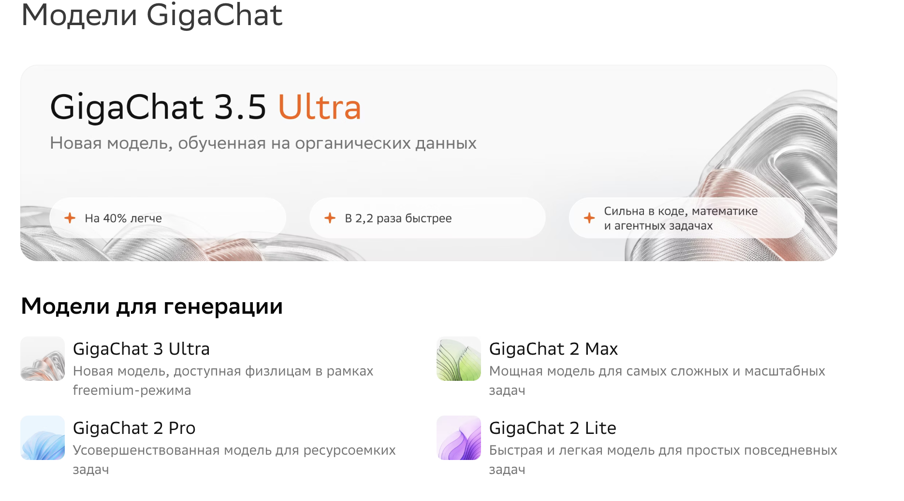
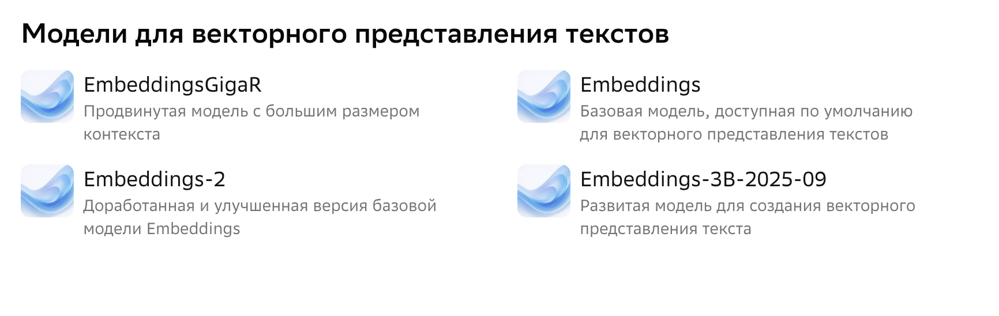

[](pyproject.toml)
[](LICENSE)
[](https://developers.sber.ru/docs/ru/gigachat/overview)

# Алина — ИИ-консультант Zerocoder для ВКонтакте

Чат-бот сообщества [Zerocoder](https://zerocoder.ru/), который отвечает на вопросы пользователей с помощью **GigaChat API**. Бот представляет онлайн-университет, консультирует по программам, форматам обучения, стоимости и карьерной поддержке, а в подходящий момент мягко предлагает заявку на консультацию.

Проект показывает полный цикл разработки AI-ассистента: интеграцию с LLM, retrieval-augmented generation (RAG) на локальной базе знаний, работу с внешним API через Long Poll, обработку ошибок, тесты и деплой.

---

## Содержание

- [Демо](#демо)
- [Возможности](#возможности)
- [Как это работает](#как-это-работает)
- [Стек](#стек)
- [Структура проекта](#структура-проекта)
- [Быстрый старт](#быстрый-старт)
- [Получение ключей](#получение-ключей)
- [Конфигурация](#конфигурация)
- [Запуск и проверка](#запуск-и-проверка)
- [Команды бота](#команды-бота)
- [База знаний и RAG](#база-знаний-и-rag)
- [Тесты и CI](#тесты-и-ci)
- [Запуск 24/7](#запуск-247)
- [Безопасность](#безопасность)
- [Ограничения](#ограничения)
- [Ветки и разработка](#ветки-и-разработка)
- [Планы](#планы)
- [Лицензия](#лицензия)

---

## Демо

| Пример диалога | Консультация по программам |
|---|---|
|  |  |

---

## Возможности

### Диалог и контент

- **Ответы только по фактам.** Источник истины — база знаний `knowledge/zerocoder.md`, собранная по официальному сайту. Если ответа нет, бот честно сообщает об этом и предлагает менеджера.
- **Контекст диалога.** Помнит последние `HISTORY_TURNS` пар сообщений; история ограничена по длине и времени жизни (`HISTORY_TTL_MINUTES`).
- **Мягкая конверсия.** Ссылка на форму заявки добавляется при интересе к цене, записи или консультации — с кулдауном, чтобы не выглядеть навязчиво.
- **Возврат к теме.** На вопросы не по теме бот вежливо возвращает разговор к обучению.
- **Команды.** `старт`, `сброс`, `помощь` и их англоязычные варианты.

### Интеграции

- **VK Bots Long Poll API** — не нужен публичный URL, домен и HTTPS-сертификат для входящих событий.
- **GigaChat API** — OAuth-токен кешируется и обновляется заранее; при `401` клиент повторяет запрос с новым токеном.
- **Обработка сбоев** — повторные попытки при `429/5xx`, переподключение Long Poll, безопасный fallback для пользователя.

### Качество и эксплуатация

- **34 unit-теста** без обращения к внешним API.
- **CI на GitHub Actions** — тесты на Python 3.10–3.12 и проверка кода `ruff`.
- **Валидация конфигурации** при старте: понятные сообщения об ошибках без раскрытия секретов.
- **Безопасные логи** — без токенов и текстов сообщений пользователей.

---

## Как это работает

```text
Пользователь ВКонтакте
        │  сообщение сообществу
        ▼
VK Bots Long Poll API ◄──── bot.py: бесконечный цикл, команды, отправка
        │
        ▼
AlinaBot (alina.py)
        │  1. достаёт историю диалога
        │  2. ищет релевантные разделы базы знаний (BM25)
        │  3. собирает system prompt + контекст
        ▼
GigaChat API /chat/completions
        │
        ▼
Ответ → очистка markdown → ссылка на форму (если уместно) → VK messages.send
```

**Ключевые решения:**

| Решение | Почему так |
|---|---|
| Long Poll вместо Callback API | Не требуется публичный сервер, домен и HTTPS |
| Локальная база знаний + BM25 | Предсказуемо, дешево по токенам, не нужна внешняя векторная БД |
| Только релевантные фрагменты в промпте | Экономия контекста и снижение галлюцинаций |
| История в памяти процесса | Простота; для продакшена легко заменить на Redis/БД |
| Кеширование OAuth-токена | Токен живёт 30 минут, лишние запросы авторизации не нужны |

Подробнее — в [docs/ARCHITECTURE.md](docs/ARCHITECTURE.md).

---

## Стек

- **Python 3.10+**
- **httpx** — HTTP-клиент для VK и GigaChat
- **python-dotenv** — конфигурация через `.env`
- **GigaChat API** — генерация ответов
- **VK Bots Long Poll API** — приём сообщений
- **GitHub Actions** — CI
- **ruff** — линтер
- **pytest** / **unittest** — тесты

---

## Структура проекта

```text
alina-ai-consultant/
├── .github/workflows/tests.yml        # CI: тесты + линтер
├── deploy/
│   ├── systemd/zerocoder-bot.service  # запуск через systemd
│   └── supervisor/zerocoder-bot.conf  # запуск через Supervisor
├── docs/
│   ├── ARCHITECTURE.md                # архитектура и решения
│   ├── DEPLOYMENT.md                  # деплой и эксплуатация
│   └── images/                        # скриншоты
├── knowledge/
│   └── zerocoder.md                   # база знаний (RAG)
├── prompts/
│   └── alina_system_prompt.md         # системный промпт Алины
├── src/alina_bot/
│   ├── __init__.py
│   ├── __main__.py                    # python -m alina_bot
│   ├── alina.py                       # логика ответов, история, CTA
│   ├── bot.py                         # VK Long Poll и команды
│   ├── config.py                      # загрузка и валидация .env
│   ├── gigachat_client.py             # OAuth + chat/completions
│   └── knowledge_base.py              # парсинг и BM25-поиск
├── tests/                             # unit-тесты
├── .env.example
├── .gitignore
├── LICENSE
├── Makefile
├── pyproject.toml
├── requirements.txt
└── README.md
```

---

## Быстрый старт

### 1. Клонирование и окружение

```bash
git clone https://github.com/elstar883/alina-ai-consultant.git
cd alina-ai-consultant

python3 -m venv .venv
source .venv/bin/activate        # macOS / Linux
# .venv\Scripts\activate         # Windows

pip install -r requirements.txt
pip install -e .
```

### 2. Конфигурация

```bash
cp .env.example .env
```

Заполните `.env` своими значениями (см. раздел [Конфигурация](#конфигурация)).

### 3. Проверка и запуск

```bash
python -m alina_bot --check   # проверить VK и GigaChat
python -m alina_bot           # запустить бота
```

После установки доступна команда `alina-bot`:

```bash
alina-bot --check
alina-bot
```

Остановка — `Ctrl+C`.

---

## Получение ключей

### Ключ сообщества ВКонтакте

1. Откройте сообщество → **Управление → Настройки → Сообщения** и включите сообщения сообщества.
2. **Работа с API → Ключи доступа → Создать ключ**, отметьте право **«Сообщения сообщества»**.
3. Включите **Long Poll API** и отметьте событие **«Входящие сообщения»** (`message_new`).
4. Числовой ID сообщества — в **Основной информации** (без минуса).

### Ключ GigaChat API

1. Зарегистрируйтесь в [GigaChat Studio](https://developers.sber.ru/studio).
2. Создайте проект **GigaChat API**.
3. В **Настройках API** получите **Authorization Key** — это `GIGACHAT_CREDENTIALS`.
4. Выберите `GIGACHAT_SCOPE` под свой тариф: `GIGACHAT_API_PERS`, `GIGACHAT_API_B2B` или `GIGACHAT_API_CORP`.

### Сертификат Минцифры

Для GigaChat API нужен корневой сертификат НУЦ Минцифры. Если при запуске возникает `CERTIFICATE_VERIFY_FAILED`:

```bash
# Вариант 1: добавить сертификат в certifi внутри venv
curl -k "https://gu-st.ru/content/lending/russian_trusted_root_ca_pem.crt" -w "\n" >> "$(python -m certifi)"

# Вариант 2: скачать сертификат и указать путь в .env
# GIGACHAT_CA_BUNDLE_FILE=./certs/russian_trusted_root_ca.pem
```

Папка `certs/` исключена из Git.

---

## Конфигурация

Все переменные читаются из `.env` рядом с корнем проекта.

### Обязательные

| Переменная | Назначение |
|---|---|
| `VK_TOKEN` | Ключ доступа сообщества ВК |
| `VK_GROUP_ID` | Числовой ID сообщества без минуса |
| `GIGACHAT_CREDENTIALS` | Authorization Key GigaChat |

Вместо `GIGACHAT_CREDENTIALS` можно указать `GIGACHAT_CLIENT_ID` + `GIGACHAT_CLIENT_SECRET` — клиент соберёт ключ сам.

### GigaChat

| Переменная | По умолчанию | Назначение |
|---|---|---|
| `GIGACHAT_SCOPE` | `GIGACHAT_API_PERS` | Тариф API |
| `GIGACHAT_MODEL` | `GigaChat-2` | Модель (`GigaChat-2-Pro`, `GigaChat-2-Max`) |
| `GIGACHAT_BASE_URL` | `https://api.giga.chat/v1` | Базовый URL API |
| `GIGACHAT_AUTH_URL` | `https://ngw.devices.sberbank.ru:9443/api/v2/oauth` | OAuth-сервер |
| `GIGACHAT_CA_BUNDLE_FILE` | — | Путь к сертификату Минцифры |
| `GIGACHAT_VERIFY_SSL` | `true` | Проверка SSL |
| `GIGACHAT_TEMPERATURE` | `0.5` | Температура генерации |
| `GIGACHAT_MAX_TOKENS` | `700` | Максимум токенов в ответе |
| `GIGACHAT_TIMEOUT` | `60` | Таймаут запроса, секунды |

### Бот и RAG

| Переменная | По умолчанию | Назначение |
|---|---|---|
| `VK_API_VERSION` | `5.199` | Версия VK API |
| `ZEROCODER_SALES_FORM_URL` | `https://zerocoder.ru/#popup:call` | Ссылка на форму заявки |
| `HISTORY_TURNS` | `8` | Глубина истории диалога |
| `HISTORY_TTL_MINUTES` | `180` | Время жизни истории |
| `KB_TOP_K` | `6` | Число разделов базы знаний в контексте |
| `KB_MAX_CHARS` | `14000` | Лимит контекста базы знаний |
| `LOG_LEVEL` | `INFO` | Уровень логирования |

---

## Запуск и проверка

### Проверка подключений

```bash
python -m alina_bot --check
```

Скрипт получает Long Poll сервер VK и список моделей GigaChat. Секреты в вывод не попадают.

### Обычный запуск

```bash
python -m alina_bot
```

В логах — сообщество, модель, статистика базы знаний. Тексты сообщений и токены не логируются.

### Makefile

```bash
make install   # создать .venv и установить зависимости
make check     # проверить подключения
make run       # запустить бота
make test      # запустить тесты
make lint      # ruff
```

---

## Команды бота

| Сообщение | Действие |
|---|---|
| `Начать`, `старт`, `/start` | Сбросить историю и поздороваться |
| `сброс`, `начать заново`, `/reset` | Очистить историю диалога |
| `помощь`, `/help`, `что ты умеешь` | Показать справку |

Остальные сообщения обрабатывает GigaChat с учётом истории и базы знаний.

---

## База знаний и RAG

`knowledge/zerocoder.md` содержит разделы о программах, форматах, стоимости, рассрочке, сертификатах, карьерном центре, Zero Kids и корпоративном обучении.

### Как работает поиск

1. Файл делится на разделы по заголовкам `##`; слишком длинные разделы — на части.
2. Текст индексируется по словам: русские окончания отсекаются, синонимы расширяют запрос.
3. Для вопроса считается **BM25**; совпадения с заголовком получают дополнительный вес.
4. В промпт попадают закреплённые разделы («О Zerocoder», «Контакты») и `KB_TOP_K` самых релевантных фрагментов, но не больше `KB_MAX_CHARS` символов.
5. Если ничего не найдено, бот не выдумывает ответ, а предлагает менеджера.

### Обновление базы знаний

- Добавляйте разделы с заголовком `## Название`.
- Указывайте `Источник: https://...`.
- Проверяйте поиск перед коммитом:

```bash
PYTHONPATH=src python -m alina_bot.knowledge_base "сколько стоит вайб-кодер"
```

Не добавляйте непроверенные цены, скидки и обещания трудоустройства.

---

## Тесты и CI

Тесты не требуют ключей и не обращаются к внешним API:

```bash
pip install -r requirements-dev.txt
pytest -v
# либо без pytest:
PYTHONPATH=src python -m unittest discover -s tests -v
```

Покрыто: конфигурация и её валидация, OAuth-ответы GigaChat, RAG-поиск и стемминг, логика Алины, CTA, очистка markdown, обработка VK-событий, разбиение длинных сообщений, история.

CI (`.github/workflows/tests.yml`) запускает тесты на Python 3.10–3.12 и `ruff check`.

---

## Запуск 24/7

Бот — долгоживущий процесс; Long Poll держит соединение с VK.

### systemd

```bash
sudo cp deploy/systemd/zerocoder-bot.service /etc/systemd/system/
sudo systemctl daemon-reload
sudo systemctl enable --now zerocoder-bot
sudo journalctl -u zerocoder-bot -f
```

### Supervisor

```bash
sudo cp deploy/supervisor/zerocoder-bot.conf /etc/supervisor/conf.d/
sudo supervisorctl reread && sudo supervisorctl update
```

Подробности, обновление и диагностика — в [docs/DEPLOYMENT.md](docs/DEPLOYMENT.md).

---

## Безопасность

- `.env` исключён из Git, в репозитории только `.env.example`.
- Токены не логируются и не отправляются пользователю.
- История диалога ограничена по длине и TTL.
- `GIGACHAT_VERIFY_SSL=false` — только для локальной отладки.
- Ограничьте права: `chmod 600 .env`.
- При утечке ключа сразу перевыпустите его в VK и GigaChat Studio.

---

## Ограничения

- Понимает только текст: фото, стикеры и документы не анализируются.
- История хранится в памяти и теряется при перезапуске.
- Один процесс — одно сообщество.
- Качество ответов зависит от модели и актуальности базы знаний.
- Бот не заменяет менеджера в вопросах оплаты, возврата и договора.
- Цены и состав программ могут меняться — базу знаний нужно периодически обновлять.

---

## Ветки и разработка

Модель ветвления:

- `main` — стабильная версия, готовая к деплою;
- `develop` — интеграционная ветка;
- `feature/<название>` — новые возможности;
- `fix/<название>` — исправления.

Коммиты — в формате [Conventional Commits](https://www.conventionalcommits.org/): `feat:`, `fix:`, `docs:`, `test:`, `chore:`.

Перед pull request:

```bash
make test
make lint
```

Подробнее — в [CONTRIBUTING.md](CONTRIBUTING.md).

---

## Планы

- [ ] Хранение истории в Redis
- [ ] Поддержка изображений (vision)
- [ ] Метрики и health-check endpoint
- [ ] Docker-образ
- [ ] A/B-тесты промптов

---

## Лицензия

Проект распространяется по лицензии [MIT](LICENSE).

Автор: **Elsa** · [GitHub @elstar883](https://github.com/elstar883)
